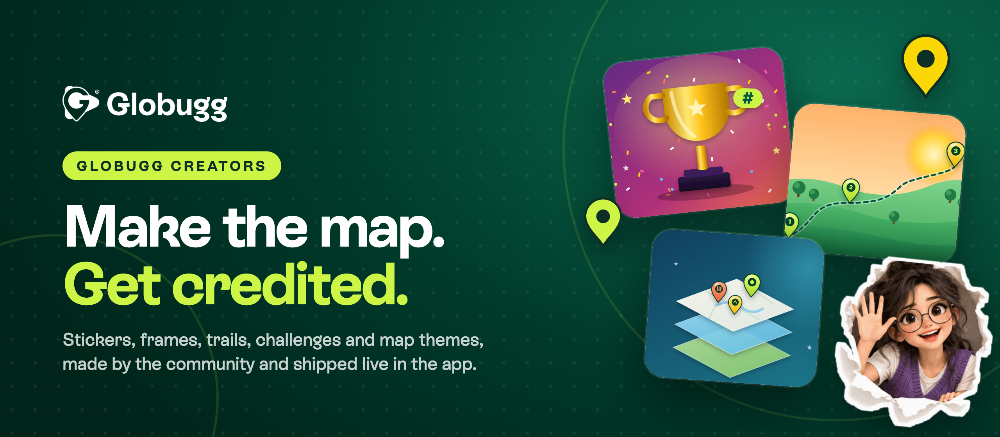
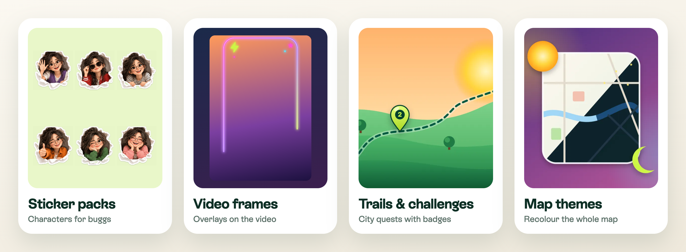

  

  
  
  
  

<h3 align="center">Every place has a moment. Help people find it.</h3>

  <b>Globugg</b> is a live map of short videos from real places. Every video, a <i>bugg</i>, is pinned where it was filmed and leaves the map within hours, so what you see is happening now. 
  This repo is where the community builds the fun parts: the stickers, frames, trails, challenges and map themes everyone uses. <b>No code needed.</b> Get merged and it ships in the app within minutes, with your name on it.

 

  

## What you can make

| | What it is | Where it shows up | Folder |
|---|---|---|---|
|  **Sticker packs** | Characters people add to their buggs | The drop screen, next to the time on every bugg | [`stickers/`](stickers/) |
|  **Video frames** | Overlays recorded on top of buggs | The drop screen, over your video | [`video-frames/`](video-frames/) |
|  **Trails** | City quests: drop a bugg at each spot to earn a badge | Explore → Trails; badges on profiles | [`trails/`](trails/) |
|  **Challenges** | Themed weeks with a hashtag, special pins and a badge | Explore, the drop screen and trophy pins on the map | [`challenges/`](challenges/) |
|  **Map layers** | Pins people can switch on: murals, skate spots, street food | Explore → Map layers | [`map-layers/`](map-layers/) |
|  **Map themes** | A colour palette for the whole map | Explore → Map themes | [`map-themes/`](map-themes/) |
|  **Sound packs** | The little tones for likes, comments, drops and boosts | Settings → Sound pack | [`sound-packs/`](sound-packs/) |
|  **Chat chips** | One-tap questions under live videos, per place type and language | The live chat | [`chat-chips/`](chat-chips/) |
|  **Ideas and bugs** | Features you want, things that broke | | [Open an issue](../../issues/new/choose) |

Looking for inspiration? **[IDEAS.md](IDEAS.md)** has ideas for each type, and what's coming next.

## How it works

<table>
  <tr>
    <td width="33%" valign="top">
       
      <b>1. Make it</b> 
      Copy the example in a folder, make it yours, and open a pull request. You can do it all in the browser: <b>Add file → Upload files</b>.
    </td>
    <td width="33%" valign="top">
       
      <b>2. Get it checked</b> 
      An automatic check tells you right away if anything needs fixing. Then the Globugg team reviews it.
    </td>
    <td width="33%" valign="top">
       
      <b>3. Ship it live</b> 
      Once merged, it's in the app within minutes, for everyone, with no app update. Credited to you.
    </td>
  </tr>
</table>

New here? **[CONTRIBUTING.md](CONTRIBUTING.md)** takes about five minutes to read.

##  Credit where it's due

Every accepted contribution names its creator: right where it shows in the app ("Stickers by" and your username), in the release notes, and in the app under **Settings → Community creators**.

## The rules

Be kind ([Code of Conduct](CODE_OF_CONDUCT.md)), only submit work you made yourself, and follow the [Community Guidelines](https://globugg.com/guidelines). Contributions are shared under [CC BY 4.0](LICENSE.md).

---

   
  Globugg is made by <a href="https://globugg.com">Bavity LLC</a> · Questions: <a href="mailto:support@globugg.com">support@globugg.com</a>

